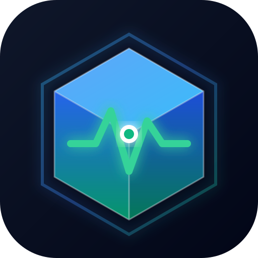

# DockMon

<p align="center">
  
</p>

<p align="center">
  <strong>A lightweight server monitoring, Docker control & Cloudflare DNS management platform</strong><br>
  Built with Go, PocketBase, and React. Fast, single-binary, and resource-friendly.
</p>

<p align="center">
  <a href="https://github.com/iamapinan/dockmon"></a>
  <a href="https://github.com/iamapinan/dockmon/blob/main/LICENSE"></a>
  
  
</p>

---

## 🌟 Highlights & Features

### 🖥️ 1. Multi-Server & System Monitoring
- **Resource Metrics**: Real-time and historical telemetry for CPU, Memory, Swap, Disk Space, Disk I/O, Network I/O, and Load Averages.
- **Hardware Telemetry**: System temperatures, CPU core breakdown, GPU usage and power draw (Nvidia, AMD, Intel), fan speeds, and battery levels.
- **Storage Diagnostics**: Disk health via S.M.A.R.T. attributes and ZFS pool health, scrub status, and datasets.

### 🐳 2. Docker Container Control & Management
- **Full Container Lifecycle**: View, **Start**, **Stop**, **Restart**, **Pause**, **Unpause**, and **Force Remove** containers directly from the web interface.
- **Live Logs Streaming**: Inspect container stdout and stderr with tailing, timestamp filtering, search, and one-click copy.
- **Container Inspect**: View container configuration, environment variables, mounts, network IP assignments, and raw JSON metadata.
- **Dual View Modes**: Switch seamlessly between **Live Control** (management actions) and **Resource Stats** (historical CPU, RAM, and Network charts).

### 🌐 3. Docker Virtual Networks & Storage Volumes
- **Virtual Networks**: Inspect all Docker networks (`bridge`, `host`, `overlay`, `macvlan`), view assigned subnets, gateways, and attached container lists.
- **Storage Volumes**: Track persistent volume mountpoints, driver types, and creation dates.
- **Lifecycle Actions**: Create new networks or volumes with custom drivers, and run one-click **Prune Unused** sweeps.

### 🌍 4. Domains & SSL Expiration Tracking
- **HTTP / HTTPS Health Probing**: Periodic and on-demand status code verification (200 OK, 404, 500) and response latency (ms).
- **SSL Certificate Monitoring**: Tracks certificate validity, issuer, and days until expiration.
- **Degraded Status Warnings**: Visual countdown and proactive warnings when certificates near expiration (<= 14 days).

### ☁️ 5. Cloudflare Connect & DNS Management
- **Zone Discovery**: Connect your Cloudflare API Token to discover and manage all account zones.
- **DNS Records Control**: View, Create, Edit, and Delete DNS records (`A`, `AAAA`, `CNAME`, `TXT`, `MX`, `NS`, `SRV`) with custom TTL and Cloudflare Proxy (Orange Cloud) toggles.
- **DNS Resolution Monitoring**: Run live DNS propagation and resolution tests comparing current DNS answers against configured records.

### 🔔 6. Centralized Alert Policies
- **Reusable Policy Rules**: Set thresholds for CPU %, Memory %, Disk %, System Down, Container Crash, Domain Down, and SSL Expiry.
- **Multi-Channel Dispatch**: Send immediate alerts via **Discord**, **Telegram**, **Slack**, **Custom Webhooks**, and **Email**.
- **Test Notifications**: Send immediate test alerts from the UI to verify webhook connectivity.

### 🌏 7. Full Internationalization (i18n)
- Native support for **English**, **Thai (ภาษาไทย 🇹🇭)**, and 30+ other languages.

---

## 🚀 Quick Start

### Using Docker Compose (Recommended)

Create a `docker-compose.yml` file:

```yaml
services:
  dockmon:
    image: dockmon:latest
    container_name: dockmon
    restart: unless-stopped
    ports:
      - "8090:8090"
    volumes:
      - ./dockmon_data:/dockmon_data
      - /var/run/docker.sock:/var/run/docker.sock
    environment:
      - APP_URL=http://localhost:8090
```

Start the service:

```bash
docker compose up -d
```

Open your browser at **`http://localhost:8090`** to set up your administrator account and start monitoring!

---

## 🛠️ Architecture

```
                  ┌──────────────────────────────────────────────┐
                  │                 DockMon Hub                  │
                  │  ┌──────────────┐  ┌───────────────────────┐ │
                  │  │  PocketBase  │  │   DockMon Background  │ │
                  │  │  Auth & DB   │  │   Manager & Probers   │ │
                  │  └──────────────┘  └───────────────────────┘ │
                  └──────────────┬──────────────────┬────────────┘
                                 │                  │
                Docker API       │                  │ SSH / WebSocket
          (/var/run/docker.sock) │                  │
                                 ▼                  ▼
                    ┌──────────────────┐  ┌──────────────────┐
                    │  Docker Daemon   │  │ DockMon / Beszel │
                    │ (Containers, Net,│  │ Remote Agents    │
                    │     Volumes)     │  │ (Multi-Server)   │
                    └──────────────────┘  └──────────────────┘
```

- **Hub**: Built on PocketBase + Go with an embedded React single-page frontend. Single executable binary.
- **Docker Integration**: Directly interacts with the Docker Engine API over `/var/run/docker.sock` without heavy external client dependencies.
- **Agents**: Lightweight monitoring agents running on remote hosts connecting back over secure WebSocket / SSH.

---

## 💻 Local Development

### Prerequisites
- [Go](https://golang.org/) 1.24+
- [Bun](https://bun.sh/) 1.1+
- [Docker](https://www.docker.com/) or [Kiri](https://kiri.app/)

### Build Steps

1. **Build Frontend**:
   ```bash
   cd internal/site
   bun install
   bun run build
   ```

2. **Build Go Binary**:
   ```bash
   cd ../..
   go build -o build/dockmon internal/cmd/hub/hub.go
   ```

3. **Run Locally**:
   ```bash
   ./build/dockmon serve --http=0.0.0.0:8090 --dir=./dockmon_data
   ```

---

## 📄 License

DockMon is licensed under the [MIT License](LICENSE).
